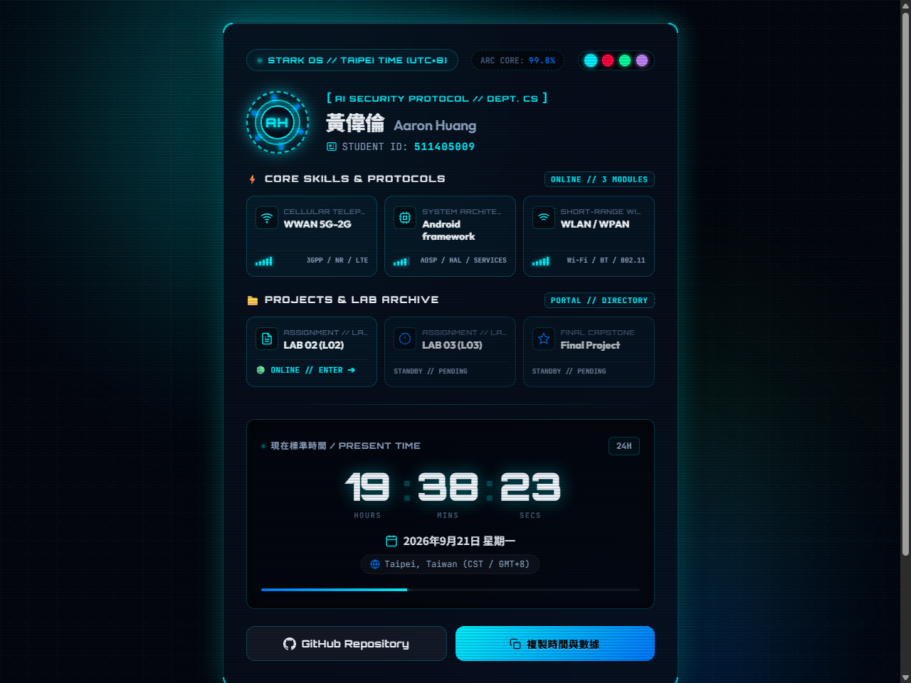

# AI Security Coursework & Homework (AI_Security_HW)

This repository contains homework assignments, lab exercises, and projects for the **AI Security** course.

[](https://aaronh945.github.io/AI_Security_HW/)

---

## 🌐 Live Demo & Interactive Hubs

| Section | Description | Live Demo URL |
| :--- | :--- | :--- |
| **Main Portal** | STARK HUD Navigation Hub & Student Portfolio | [Visit Main Hub](https://aaronh945.github.io/AI_Security_HW/) |
| **Lab 02 (L02)** | Lab 02 Interactive Interface & Telemetry | [Visit Lab 02](https://aaronh945.github.io/AI_Security_HW/L02/) |
| **Lab 03 (L03)** | CWA 台灣氣象站地圖 & PostgreSQL 系統 (JavaScript) | [Visit Lab 03](https://aaronh945.github.io/AI_Security_HW/L03/) |
| **Lab 03_1 (L03_1)** | CWA 台灣氣象站地圖 (Python + Vercel Edition) | [Visit Lab 03_1](https://aaronh945.github.io/AI_Security_HW/L03_1/) |
| **Lab 04_1 (L04_1)** | Top 5 特徵選擇演算法互動式評估套件 (50 Startups & Boston Housing) | [Visit Lab 04_1](https://aaronh945.github.io/AI_Security_HW/L04_1/) |
| **Lab 04_2 (L04_2)** | Top 5 特徵選擇演算法分析套件 (Kaggle S5E10 道路事故風險預測) | [Visit Lab 04_2](https://aaronh945.github.io/AI_Security_HW/L04_2/) |
| **Final Project** | Capstone Final Project Hub | *Standby / Pending* |



---

## 📂 Repository Structure

```text
AI_Security_HW/
├── index.html        # STARK HUD Main Portal & Directory
├── style.css         # Sci-Fi UI Styling & Themes
├── app.js            # Real-time Clock, Telemetry & Theme Switcher
├── screenshot.png    # Portal Preview Screenshot
├── package.json      # Dependencies (pg for PostgreSQL)
├── vercel.json       # Vercel Deployment & Cron Configuration
├── README.md         # Main Project Overview & Documentation
│
├── api/              # Vercel Serverless Functions (Node.js)
│   ├── weather.js    # Weather query endpoint (PostgreSQL / CWA Fallback)
│   └── sync.js       # CWA to PostgreSQL sync & Cron handler
│
├── lib/              # Backend Modules (Node.js)
│   ├── db.js         # PostgreSQL connection & Auto-schema
│   └── cwa.js        # CWA Open Data fetcher & parser
│
├── L02/              # Lab / Homework 02
│   ├── index.html    # Lab 02 Dedicated Interface
│   ├── style.css     # Lab 02 Styling
│   ├── app.js        # Lab 02 Script
│   ├── screenshot.png# Lab 02 Preview Screenshot
│   └── README.md     # Lab 02 Overview
│
├── L03/              # Lab / Homework 03 (JavaScript + Vercel Edition)
│   ├── index.html    # Leaflet 台灣氣象站地圖
│   ├── style.css     # HUD 樣式與溫度色階
│   ├── app.js        # 地圖 Marker 渲染與遙測邏輯
│   ├── taiwan-counties.json # 台灣行政區 GeoJSON
│   ├── screenshot.png# L03 預覽截圖
│   ├── sql/schema.sql# PostgreSQL DDL
│   └── README.md     # L03 文件與部署步驟
│
├── L03_1/            # Lab / Homework 03_1 (Python + Vercel Edition)
│   ├── index.html    # Leaflet 台灣氣象站地圖主頁面
│   ├── style.css     # 科幻 HUD 樣式
│   ├── app.js        # 地圖互動與 Python API 串接
│   ├── server.py     # 本地 Python 開發伺服器 (包含 API 與靜態資源)
│   ├── requirements.txt # Python 依賴 (psycopg2-binary, requests)
│   ├── vercel.json   # Vercel Python Runtime 與 Cron 配置
│   ├── api/          # Vercel Python Serverless Functions
│   │   ├── weather.py# /api/weather 氣象觀測資料端點
│   │   └── sync.py   # /api/sync 定時同步至 PostgreSQL 端點
│   ├── lib/          # Python 後端核心模組
│   │   ├── cwa.py    # CWA API 介接與清洗
│   │   └── db.py     # PostgreSQL 連線池與自動 Schema
│   ├── sql/schema.sql# PostgreSQL DDL
│   └── README.md     # L03_1 Python 詳細架構與部署文件
│
├── L04_1/            # Lab / Homework 04_1 (Top 5 特徵選擇演算法互動式評估套件 - Python)
│   ├── app.py        # 100% Pure Python Streamlit 互動應用程式
│   ├── requirements.txt # Python 依賴套件 (streamlit, pandas, scikit-learn, matplotlib)
│   ├── index.html    # Stlite WebAssembly 瀏覽器運行入口 (GitHub Pages)
│   ├── 50_Startups.csv # 50 Startups 原始資料集
│   ├── BostonHousing.csv # Boston Housing 原始資料集
│   ├── .nojekyll     # GitHub Pages 靜態構建支援
│   └── README.md     # Lab 04_1 技術文件與本機 / 雲端運行說明
│
├── L04_2/            # Lab / Homework 04_2 (Top 5 特徵選擇 - Kaggle S5E10 道路事故風險預測)
│   ├── app.py        # 100% Pure Python Streamlit 互動應用程式
│   ├── requirements.txt # Python 依賴套件 (streamlit, pandas, scikit-learn, matplotlib)
│   ├── index.html    # Stlite WebAssembly 瀏覽器運行入口 (GitHub Pages)
│   ├── train.csv     # Kaggle S5E10 訓練資料集 (10,000 筆樣本)
│   ├── s5e10_precomputed.json # 預計算特徵步階指標加速檔
│   ├── .nojekyll     # GitHub Pages 靜態構建支援
│   └── README.md     # Lab 04_2 技術文件與本機 / 雲端運行說明
│
└── Final/            # Final Capstone Project
```

## 📝 License

This project is for educational and coursework purposes.
